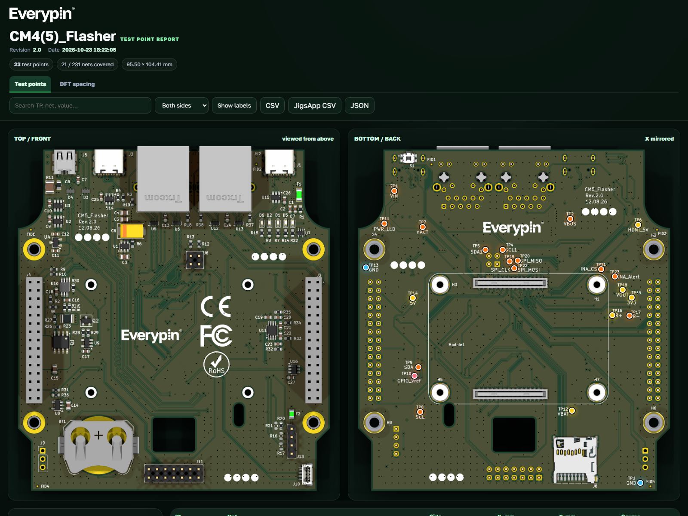
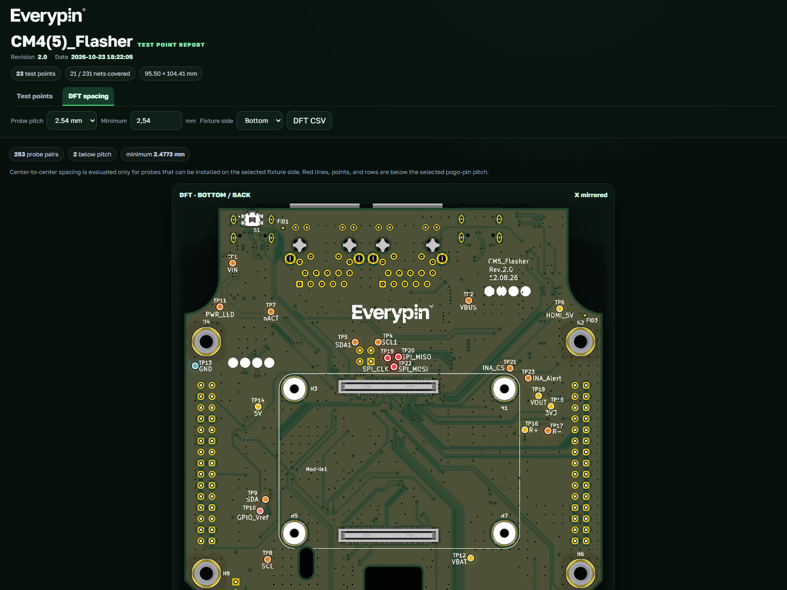

# Every Test Point

[](https://github.com/everypinio/everytestpoint/actions/workflows/ci.yml)
[](LICENSE)

Every Test Point is a KiCad 10 IPC plugin that turns the open PCB into a self-contained,
interactive test-point report.

One click in PCB Editor creates `<board-name>-testpoints/` next to the board with:

- `index.html` — searchable top/bottom board map and test-point table;
- `testpoints.csv` and `testpoints.json` — complete structured exports;
- `jigsapp-testpoints.csv` — TheJigsApp-compatible probe table;
- `dft-distances.csv` — every same-side probe pair, sorted by center distance;
- `images/top.png` and `images/bottom.png` — realistic KiCad 3D renders.

The extractor accepts both KiCad's pad fabrication property `Test point pad` and conventional
single-pad `TP…` footprints. A through-hole pad on a fitted component is available to probes only
from the side opposite the component. Mark an unpopulated through-hole footprint as **DNP** in
KiCad to make its pads available from both sides.

The report header uses the Everypin wordmark and records the project revision plus the report
generation date and time. Revision is read from the KiCad project text variable `REVISION`, with
PCB and main-schematic title blocks used as fallbacks.

All report typography uses the bundled Golos Text variable font. Its SIL Open Font License is
included at `plugin/everytestpoint/GolosText-OFL.txt`.

The **DFT spacing** tab shows the board and a complete pairwise spacing table for each fixture
side. Select a standard pogo-pin pitch or enter a custom minimum; every pair below the threshold
is highlighted in red on the board and in the table.

## Report preview

Test-point map with realistic top and bottom board renders:



DFT spacing analysis with pogo-pin pitch conflicts highlighted in red:



## Install

KiCad 10 is required. Enable **Preferences → Plugins → Enable KiCad API** before using the
plugin.

Until Every Test Point is accepted into the official KiCad repository:

1. Download `every-test-point-<version>.zip` from the
   [latest GitHub release](https://github.com/everypinio/everytestpoint/releases/latest).
2. In KiCad, open **Plugin and Content Manager → Install from File** and select the ZIP.
3. Restart PCB Editor if the toolbar action does not appear immediately. KiCad may need a short
   time to create the plugin's Python environment and install its dependencies.

Once published in the official repository, it can be installed by searching for
**Every Test Point** in Plugin and Content Manager.

Early development builds used a different internal identifier. If KiCad shows both variants,
remove `com.everypin.every-test-point` once before installing the current package.

## Install for development

1. Enable **Preferences → Plugins → Enable KiCad API** in KiCad 10.
2. Copy the `plugin` directory to the KiCad IPC plugin directory and rename it to
   `every-test-point`:
   - Windows: `%USERPROFILE%\Documents\KiCad\10.0\plugins\every-test-point`
   - Linux: `~/.local/share/KiCad/10.0/plugins/every-test-point`
   - macOS: `~/Documents/KiCad/10.0/plugins/every-test-point`
3. Restart PCB Editor. KiCad creates the plugin virtual environment and installs the declared
   Python dependencies automatically.
4. Open a board and run **Generate test-point map** from the PCB Editor toolbar or plugin menu.

The generated HTML is opened in the default browser. The board is saved before rendering so the
report always matches the visible editor state.

The renderer automatically measures the opaque Edge.Cuts surface inside each PNG. Marker
coordinates are mapped into that measured rectangle, excluding KiCad camera padding, shadows,
and any 3D models that extend beyond the board edge.

## Command line

The report generator can also be tested without the KiCad IPC connection:

```powershell
python -m plugin.everytestpoint.cli path\to\board.kicad_pcb --no-render
```

Remove `--no-render` to use `kicad-cli pcb render`.

## Build a PCM archive

```powershell
python scripts\build_pcm.py
```

The archive is written to `dist/every-test-point-<version>.zip` with the KiCad 10 PCM layout.
The build is reproducible: identical sources produce an identical ZIP and SHA-256 hash.

Validate the manifests and archive against the KiCad schemas:

```powershell
python -m pip install -r requirements-dev.txt
python scripts\validate_release.py
```

## Test

```powershell
python -m unittest discover -s tests -v
```

CI runs the tests and package validation on Windows, macOS, and Linux. A tag matching
`v<plugin/VERSION>` creates a GitHub release automatically, including the PCM ZIP, checksum, and
official-repository metadata. Maintainer instructions are in
[`docs/RELEASING.md`](docs/RELEASING.md).

## Design notes

KiCad 10's IPC API is used to identify and save the open board and to locate `kicad-cli`.
Test-point extraction intentionally reads the serialized `.kicad_pcb` S-expression: stable
`kicad-python` releases for KiCad 10 do not yet expose every pad fabrication-property field.
The parser never executes board content.

The original JigsApp plugin inspired the fabrication-property convention and compatible CSV
columns: <https://github.com/TheJigsApp/kicad-testpoints-pcm>.

## License

MIT. See `LICENSE`.
